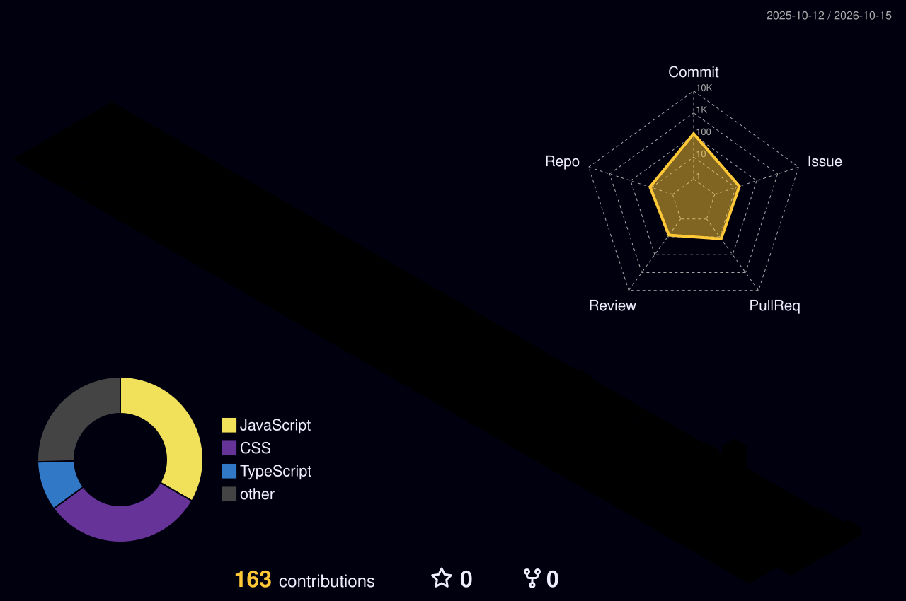

<!-- minnnnnngun GitHub Profile README -->

  

<h1 align="center">안녕하세요, minnnnnngun입니다 👋</h1>

  프론트엔드와 UI 인터랙션을 탐구하며, 작은 것을 빠르게 만들고 배웁니다.

## Tech Stack

  
  &nbsp;
  
  &nbsp;
  
  &nbsp;
  
  &nbsp;
  

## 📊 GitHub Stats

  

## 🔥 Most Used Language

  

## 🌈 Contribution Map

  

## 📫 Contact

  
  &nbsp;
  

  <em>Keep building. Keep exploring. 🚀</em>

